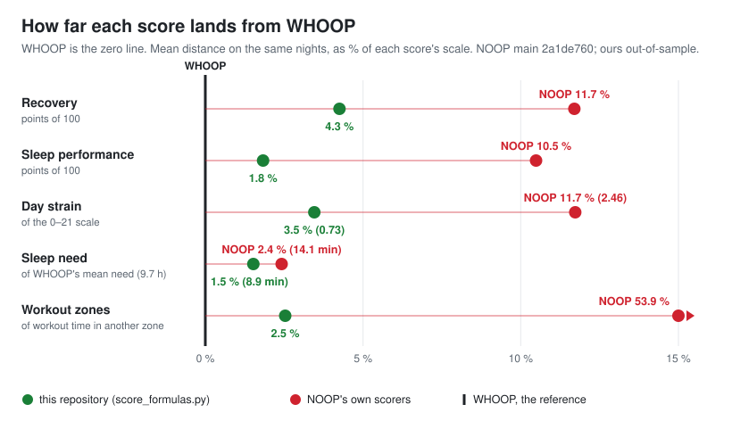
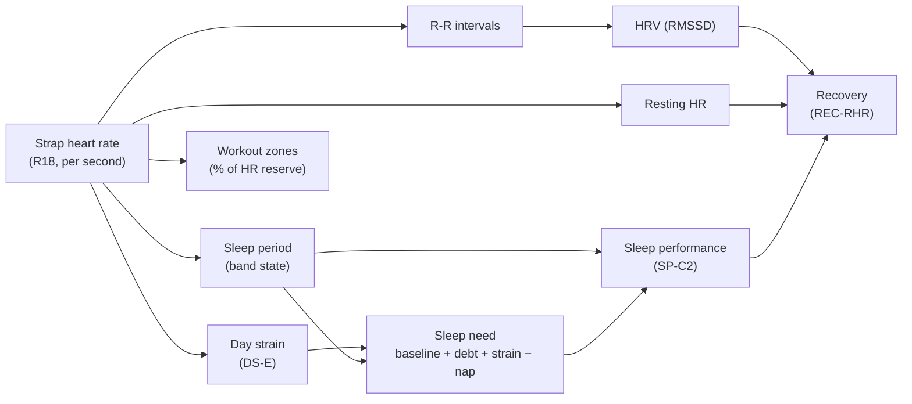

<h1 align="center">wearable5.0</h1>

<p align="center">
  <b>A reverse-engineered scoring model and an open, tested protocol library for the WHOOP&nbsp;5.0&nbsp;/&nbsp;MG band.</b><br>
  Recovery, sleep and strain closer to WHOOP than NOOP today, from your own strap over Bluetooth LE.
</p>

<p align="center">
  
  
  
  
  
</p>

---

`wearable5.0` does two things for the WHOOP 5.0 / MG band, and both exist to make
[NOOP](https://github.com/ryanbr/noop) better:

1. **A reverse-engineered scoring model.** WHOOP computes Recovery, Sleep performance, sleep need and Day Strain on its servers,
   so there is no formula in the app to read. This repository rebuilt them from WHOOP's own input/output pairs. On the same nights,
   cycles and workouts, it lands closer to WHOOP than NOOP's own scorers on every score. One command reproduces the comparison.
2. **An open, tested protocol library.** One canonical, versioned description of the 5/MG wire protocol, with matching decoders in
   Python, Swift and Kotlin that are tested against each other and against frames from real straps. It is the 5/MG counterpart of
   [johnmiddleton12/wearable](https://github.com/johnmiddleton12/wearable) (WHOOP 4.0).

> [!IMPORTANT]
> Independent interoperability research. **Not affiliated with WHOOP, Inc.** Not a medical device.
> This library parses and builds bytes; it never connects to a device by itself. See
> [DISCLAIMER.md](DISCLAIMER.md).

## At a glance

<p align="center">
  
</p>

Scope, stated plainly: one WHOOP 5.0 wearer; 12 to 16 nights, 11 cycles and 5 workouts with WHOOP's scores from the official
developer API; NOOP `main` at `2a1de760`. NOOP's code runs unchanged. Every number of ours is out-of-sample: leave-one-out with
the constants refitted per fold, or a rule frozen before the data. The one exception is sleep need, whose baseline and
recent-strain constants were fitted on these nights; they account for seconds of its error at most. Full method and every
caveat: [NOOP_HANDOFF.md](NOOP_HANDOFF.md).

## What NOOP does today, and what this repository adds

NOOP descriptions are read from its source at `2a1de760`. Each row links to the code that computes our side.

### Scores

| | NOOP today | This repository | Mean off WHOOP, NOOP → ours |
|---|---|---|---|
| **Recovery** | Charge: logistic (k = 1.6) over weighted z-scores: HRV 0.55, resting HR 0.20, sleep 0.15, respiration 0.05, skin temperature 0.05 | HRV against a shrunken own baseline, sleep against its own mean, and resting HR ([`recovery_lead`](re/score_formulas.py)) | 11.9 → **4.1** points |
| **Sleep performance** | Rest: 0.50 duration against need + 0.20 efficiency + 0.20 deep and REM share + 0.10 consistency | A power of asleep/need plus consistency ([`sleep_performance`](re/score_formulas.py)) | 10.1 → **1.5** points |
| **Sleep need** | 8 h (raised for long sleepers) plus 55 % of unmet need carried forward | Baseline + debt + recent-strain need − nap; debt is 1/2 or 9/14 of the last scored shortfall, capped at 7,668,000 ms ([`debt_ms`, `strain_need_ms`](re/score_formulas.py)) | 17.0 → **6.9** min |
| **Day strain** | Edwards TRIMP on 50–90 % HRR zones, then 100 · ln(TRIMP + 1) / ln 7201 | A power of exponentially weighted minutes above 94 bpm ([`day_strain`](re/score_formulas.py)) | 2.46 → **0.73**; 2.30 → **0.13** without skiing or weightlifting |
| **Workout zones** | 50/60/70/80/90 % of maximum HR | 40/60/70/80/90 % of heart-rate reserve, frozen before the workouts it was tested on ([ZR-1, `re/hrr_zones.py`](re/hrr_zones.py)) | 54 % → **2.5 %** of workout time in another zone |

Rules and constants, with what was tried and ruled out: [re/SCORE_MODELS.md](re/SCORE_MODELS.md). Evidence:
[FINDINGS §18](FINDINGS.md#18-first-comparison-with-the-whoop-app-on-the-same-nights-own-strap-new). What NOOP would change, file by
file: [NOOP_HANDOFF.md](NOOP_HANDOFF.md#score-changes-noop-can-make).

### Sync and protocol

| | NOOP today | This repository | Evidence |
|---|---|---|---|
| **Newest-page clock** in GET_DATA_RANGE | timestamp scan, not fed to 5/MG sync | read field-exact at body offset 57 | 589 replies, 21 sessions ([§3](FINDINGS.md#3-what-the-official-app-does-on-the-phone-apk)); [PR #2824](https://github.com/ryanbr/noop/pull/2824) |
| **History auto-continue** | keeps going at 0 pages behind | stops, because backlog = write − trim | [§3](FINDINGS.md#3-what-the-official-app-does-on-the-phone-apk); [PR #2823](https://github.com/ryanbr/noop/pull/2823) |
| **Command table** | 80 commands | 87, including the new clock pair 146/147 and 155–159 (certificate transfer, `LOCK_DEVICE`), plus events 109 and 123 | the official app 5.473.0 and 5.475.0; [PR #2828](https://github.com/ryanbr/noop/pull/2828) |
| **R26 heart rate** | none | autocorrelation with an acceptance filter: 1.48 bpm on 391 of 1,145 bursts asleep, against 6.24 for a shuffled control | [§16](FINDINGS.md#16-r26-heart-rate-fails-awake-cause-and-quality-filter-own-strap-new) |
| **Where the scores come from** | — | proven computed on WHOOP's servers: no formula in the app | [§3](FINDINGS.md#3-what-the-official-app-does-on-the-phone-apk) |

### Metrics checked against WHOOP

Thresholds fixed before the data ([`CRITERIA`](re/validate_own_strap.py)); 5 paired nights.

| Metric | Mean off WHOOP | Verdict |
|---|---|---|
| HRV (RMSSD) | 2.53 ms, r = 0.77 | Proven |
| Respiratory rate from R-R | 0.12 per min, r = 0.73 | Proven |
| Skin temperature | 0.17 °C, r = 0.81 | Proven |
| Sleep onset | 14.3 min median; a near-constant lag | Proven |
| Resting HR | 3.89 bpm low, almost all of it a constant offset | Failed at 3 bpm; the offset is a lead |
| Wake time | 49.5 min median | Failed |

## How the score model fits together



All of it is in [`re/score_formulas.py`](re/score_formulas.py), standard library only.

## Reproduce it

```bash
# NOOP's own scorers, from upstream main (a fork or feature branch would score a modified NOOP)
git clone https://github.com/ryanbr/noop ../noop-upstream
(cd re/noop_scores && swift build -c release)

# your own data: an API snapshot (re/whoop_api_fetch.py) and a folder of your strap's frames
python3 re/noop_compare.py <API snapshot> <strap data>   # the full head-to-head, aggregates only
python3 re/plot_headtohead.py <its --json output> docs/headtohead.svg
```

Every claim from the WHOOP export and API is rechecked by [`re/verify_findings.py`](re/verify_findings.py), which fails loudly when
one stops holding. Every analysis script is listed in [re/README.md](re/README.md).

## Features

| | |
|---|---|
| **Canonical schema** | [`protocol/whoop5_protocol.json`](protocol/whoop5_protocol.json): GATT, envelope, 87 commands (82 from the current official app plus 5 firmware-only ones documented by NOOP), 58 events, 16 packet types, response bodies and record layouts. Every entry is tagged with where the fact comes from. |
| **Byte-exact framing** | CRC16-Modbus header, CRC32 body, 4-byte padding, BLE fragment reassembly. Reproduces the strap's CLIENT_HELLO and history ACK byte for byte. |
| **Experimental metrics** (SpO₂, HRV, sleep, breathing, temperature, R26 HR) | `spo2_percent` from R18 byte 82 and `spo2_windows()` for one value per overnight measurement window; `rmssd_ms()` on R18 R-R; `sleep_periods()` (onset/offset, HR min/mean), `respiratory_rate()` from R-R (14.1 breaths/min on the captured night), `skin_temp_baseline()` (nightly mean/min/max, deviation), `hr_from_r26()` (1.7 bpm vs R18 on accepted bursts, mostly asleep; §16). In Python (`whoop5.experimental`, stdlib only), Swift and Kotlin (`Whoop5Experimental`); the three agree on the captured night to the last bit except trigonometry rounding in the last digit; see [§15](FINDINGS.md#15-experimental-metrics-sleep-periods-breathing-skin-temperature-r26-heart-rate-corpus-new). |
| **Record decoders** | Live HR + R-R (packet 40), R18 biometric summary, R20 optical blocks, R21 six-axis IMU, R22 v9 channels, R26 compact optical, R16/R17 MG ECG, IMU streams 51/52, events with payloads, console log text, history metadata. Unknown layouts are preserved raw, never dropped. |
| **Sync support** | Field-exact `GET_DATA_RANGE` (page backlog and newest-page clock) and the `HISTORICAL_DATA_RESULT` ACK built from the verbatim HISTORY_END token. |
| **Safety list** | The commands that can brick, wipe or lock a strap are flagged `destructive` in the schema and exposed in both languages. |
| **Two languages, one truth** | Python (stdlib only) and a Swift package. Parity is enforced by golden vectors in CI, and both agree on 30,559 real 5/MG frames (190,883 field checks). |
| **Tested on real data** | An opt-in regression runs every decoder over a 31,489-frame 5/MG corpus rebuilt from public sources (`re/`). |
| **New research** | R-R is in **milliseconds**, not 1/1024 s ([§8](FINDINGS.md#8-r-r-intervals-are-in-milliseconds-corpus)); heart rate from raw R26 and R20 optical data ([§11](FINDINGS.md#11-r26-compact-optical-corpus-new), [§4](FINDINGS.md#4-r20-optical-the-pulse-channels-corpus-new)); the official app's sync cadence and feature-flag values ([§10](FINDINGS.md#10-what-the-official-app-sends-corpus-new)); overnight **SpO₂** decoded from R18 byte 82 ([§13](FINDINGS.md#13-spo-in-r18-byte-82-corpus-new--experimental)). |

## Repository layout

```
protocol/                 whoop5_protocol.json: the single source of truth (edit only this)
python/whoop5/            reference decoder (framing, decode, synthetic frames)
python/tests/             unit tests, including real frames from 5/MG straps
Packages/Whoop5Protocol/  Swift package + whoop5-decode CLI
kotlin/                   Kotlin/JVM library (no Android dependency), for Android apps such as NOOP's
fixtures/golden.json      cross-language parity vectors (generated)
re/                       reverse-engineering analyses and their results
docs/                     the head-to-head chart (generated by re/plot_headtohead.py)
scripts/sync-schema.sh    copies the schema to every consumer and regenerates vectors
FINDINGS.md               the protocol write-up and evidence
```

## Getting started

**Python**

```bash
cd python && python3 -m unittest discover -s tests
```

```python
from whoop5 import Reassembler, decode_frame, history_ack

r = Reassembler()
for notification in notifications:              # bytes from fd4b0003 / fd4b0004 / fd4b0005
    for frame in r.feed(notification):
        packet = decode_frame(frame)
        if packet.get("meta_name") == "HISTORY_END":
            ack = history_ack(bytes.fromhex(packet["end_token_hex"]))   # send only after you persisted the chunk

from whoop5.experimental import spo2_windows, rmssd_ms   # experimental, see FINDINGS §13
nightly_spo2 = spo2_windows(r18_records)                 # [{"start_unix", "spo2_percent", ...}, ...]
from whoop5.experimental import sleep_periods, respiratory_rate, skin_temp_baseline, hr_from_r26  # FINDINGS §15
nights = sleep_periods(r18_records)                      # [{"onset_unix", "offset_unix", "hr_min", "hr_mean", ...}]
```

**Swift** (add `Packages/Whoop5Protocol` as a local or remote package)

```swift
import Whoop5Protocol

var reassembler = Whoop5Reassembler()
for frame in reassembler.feed(notificationBytes) {
    switch try Whoop5Decoder.decode(frame) {
    case .record(_, .biometric(let r18)):  print(r18.heartRate, r18.rrMs, r18.skinTempC ?? .nan)
    case .commandResponse(let c):          print(c.commandName, c.dataRange?.pagesBehind ?? 0)
    default:                               break
    }
}
```

```bash
cd Packages/Whoop5Protocol
swift test                                                # requires Xcode (XCTest)
swift run whoop5-decode --parity ../../fixtures/golden.json   # works with Command Line Tools only
swift run whoop5-decode aa0108000001e67123019101363e5c8d
```

**Changing the protocol:** edit `protocol/whoop5_protocol.json`, run `scripts/sync-schema.sh`,
then run both test suites. CI fails if the copies drift.

## Verification status

Every fact carries one of these evidence levels (defined in the schema):

| Level | Meaning |
|---|---|
| **corpus** | Verified in this repository on frames captured from real 5/MG straps. |
| **apk** | Read from static analysis of the official Android app (5.473.0), facts only. |
| **community** | Documented by NOOP, goose, OpenStrap or Johga; partly hardware-confirmed by them. |
| **constructed** | An arithmetic or structural rule with no physical validation. |

| Area | Level |
|---|---|
| Envelope, CRCs, padding, reassembly | corpus |
| CLIENT_HELLO, HISTORY_END token, history ACK | corpus |
| Command / event / packet-type numbers, destructive set, device families | apk |
| GET_DATA_RANGE cursor fields and newest-page clock | corpus (589 replies, 21 sessions) + apk |
| R18 heart rate, R-R (ms), steps, skin temperature, band state | corpus (20,274 records, one full night) + community |
| R-R unit (R18, 0x2A37; packet 40 moderate) | corpus (beat-for-beat match + phone clock) |
| R20 block layout and which channels carry the pulse | corpus |
| R26 contiguity and heart rate | corpus (17 overnight bursts) |
| R16/R17 MG ECG structure, event payloads, console text | corpus + community |
| Feature-flag keys and the official app's values | corpus |
| R21, R22, packets 51/52 | community |

## Open items: what still needs a WHOOP 5.0

**Short answer: yes.** The library is complete for framing, history sync and record *structure*.
Several *meanings*, scales and behaviours have only been inferred, or confirmed on one strap, one
firmware or one night. Each item below needs either a strap in hand or captures donated by
owners. None of them blocks using the library; they limit how far a client should trust a field.

### Needs a strap (live interaction)

| # | Item | Current state | How to verify |
|---|---|---|---|
| H1 | Full connect → bond → hello → sync session on iOS, macOS and Android | **macOS done** on one strap on this library's framing; iOS and Android not run | Same session through a client on those platforms |
| H2 | Bonding refusals on some Android phones | Strap refuses SMP pairing in an HCI capture (NOOP #1635); cause open | Controlled pairing attempts with HCI logging |
| H9 | Re-reading trimmed history | **Works on one strap** (fw 50.43.2), §17 | Other firmware and straps |
| H4 | HISTORY_END token second word (write-wrap state) | **Closed on one strap**: the firmware calls it the wrap count, and pages above the write head are one lower (§17) | Other firmware |
| H5 | R21 IMU scale (4096 LSB/g, ±2000 °/s) and 100 Hz rate | **Accel closed on one strap**: 1.003 g over 71,019 still seconds (§18). Gyro samples are present, gyro scale open | One timed 360° rotation |
| H6 | Dedicated IMU stream packets 51/52 | Layout documented, never observed | Enable IMU streaming and capture |
| H7 | Command bodies for alarms, haptics, LED/TIA config | Feature-flag and device-config writes now documented from the official app (FINDINGS §10); alarm/haptic bodies decoded from the app (§19); LED/TIA bodies and on-strap responses still missing | Capture the official app setting an alarm/LED; read back the responses |
| H8 | Format-2 envelope | Exists, negotiation unknown | Observe a session that switches format |

### Needs more data (a strap, or donated captures)

| # | Item | Current state | Data that settles it |
|---|---|---|---|
| D1 | R20 LED wavelengths (which source is green, red, infrared) | Source codes 1–4 seen; identity unknown | Captures across a toggle of the `ir_hw_switching` feature flag, or with a known light source |
| D2 | SpO₂ | **Proven that R18 byte 82 is the strap's SpO₂ reading**: 30 s windows every 20 min during sleep on 3 straps (§13). Against the WHOOP app on 5 nights: 0.53 % mean off, but r = 0.49, and byte 42 follows WHOOP more closely (§18) | What byte 42 holds; more nights and straps for the trend |
| D3 | Sleep detection and stages | Sleep periods from R18 band state (`sleep_periods`): onset 14.3 min median off on 5 nights, a near-constant lag; wake 49.5 min off (§15, §18). No stages | Wake detection that sees lying awake before rising; stages from the WHOOP export |
| D4 | HR from optical | R26: 1.7 bpm on the 98 of 286 bursts `hr_from_r26` accepts, 0.92 bpm on 82 new ones, nearly all asleep; no usable reading awake and moving (§16, §18). R20: r ≈ 0.8, ~2 bpm on one resting session; **fails** on a second, awake session with a sparse reference (§14) | R20 with motion and a dense reference; more wearers |
| D5 | Dense overnight HRV | **Closed on one strap**: R18 delivers 92 % of beats overnight with R-R in ms (§12); 2.53 ms from WHOOP, r = 0.77, on 5 nights (§18) | More wearers |
| D6 | Respiratory rate | No field on the wire; derived from R-R sinus arrhythmia (`respiratory_rate`): 0.12 per min from WHOOP, r = 0.73, on 5 nights (§15, §18) | More wearers |
| D7 | Skin temperature (R18 `u16@73 / 100 °C`) across firmware | Agrees across three sources; 0.17 °C from WHOOP, r = 0.81, on 5 nights (§18); firmware 50.37–50.43 seen | R18 from other firmware with the WHOOP export |
| D8 | R18 provisional fields | Byte 82 and status words 77/79 tied to the 20-minute measurement windows; bytes 106–113 characterised but unexplained (§12, §13) | Correlation against a WHOOP export over many nights |
| D9 | R22 v9 channel meaning and R26 sample units | Structure only | Captures with the related feature flags toggled |
| D10 | Event payloads | Header, payload length and BATTERY_LEVEL payload decoded; 8 unnamed event numbers seen; other payloads opaque (§9) | More captures of each event |

## How it compares

Protocol rows checked on 2026-10-19 against the source of each project; score rows on 2026-11-19 against NOOP `main` at
`2a1de760`. Goose and NOOP are full apps; this repository is a protocol library with score formulas, so the comparison leaves
out what only an app has.

| | wearable5.0 | [goose](https://github.com/b-nnett/goose) (archived) | [NOOP](https://github.com/ryanbr/noop) 5/MG path |
|---|---|---|---|
| Format-1 framing, CRCs, reassembly | ✅ strict (rejects bad CRC) | ✅ lenient (keeps truncated / bad-CRC frames with warnings) | ✅ |
| Command table | 87, with source per entry | 75, with risk gates | 80 |
| Commands 146–147, 155–159 (new clock pair, certificates, `LOCK_DEVICE`) | ✅ | — | — |
| Event table | 58 | 33 | 58 |
| HISTORY_END token and ACK | ✅ | ✅ | ✅ |
| GET_DATA_RANGE backlog in pages | ✅ | ✅ | ✅ (diagnostic only) |
| GET_DATA_RANGE newest-page clock (field-exact) | ✅ | — | — (timestamp scan, not fed to 5/MG sync) |
| R18 fields (HR, R-R, gravity, steps, skin temp, band state) | ✅ | header + HR byte | ✅ |
| R-R unit | ✅ ms (proven on captures) | — | ✅ ms (fixed in #2046 / #2195) |
| MG ECG R16/R17 | ✅ | — | ✅ |
| Event payloads, console text | ✅ | names only | ✅ (console), partial events |
| R20 optical blocks, all ten channels | ✅ | — | ✅ |
| R21 IMU arrays, R26 delta reconstruction, R22 v9 | ✅ | summaries | ✅ |
| HR from raw optical (R26, R20) | ✅ with controls; R20 limited (§14) | — | ✅ PPG heart rate |
| Official app's feature-flag values and sync cadence | ✅ | — | flag keys only |
| SpO₂ (R18 byte 82) | 🧪 decoded, per-window helper and measurement schedule | — | 🟡 tri-mode candidate, not shown as a metric |
| Device-family table incl. battery-pack service | ✅ | partial | `1150…` listed as unsupported |
| Machine-readable schema with evidence per fact | ✅ | — | ✅ (no per-fact source) |
| Python + Swift + Kotlin with enforced parity | ✅ | Rust + Swift | Swift + Kotlin |
| Score formulas checked against WHOOP's own values | ✅ out-of-sample, closer than NOOP on every score ([above](#what-noop-does-today-and-what-this-repository-adds)) | — | own scorers (Charge, Effort, Rest) |
| WHOOP's workout zones (% of heart-rate reserve from 40 %) | ✅ | — | % of max HR from 50 % |
| BLE client, storage, UI | — (out of scope) | ✅ | ✅ |

Most protocol offsets here were first documented by NOOP and goose; this repository consolidates
them, adds the current app's tables, and contributes findings from real captures: the GET_DATA_RANGE
newest-page clock on 589 replies, the official app's feature-flag values and sync cadence, the byte-82
measurement schedule, and independent confirmation of results NOOP reached first (R-R in ms, byte 82
as SpO₂, optical heart rate). Other community
decoders exist, for example [whoop-local](https://github.com/a9eelsh/whoop-local) (single-file
Python, derives HRV from R26).

## Using it from NOOP

NOOP is what this project is for. [NOOP_HANDOFF.md](NOOP_HANDOFF.md) lists each change NOOP can take: the score formulas with their
head-to-head against NOOP's own scorers, the protocol fixes, and the metrics on 5 paired nights. Each row says what to change, the
evidence, where it goes in NOOP, and the open PR if there is one.

## Contributing data

The open items above are mostly a data problem. If you own a 5.0 or MG, one command turns what you
already have into a privacy-safe donation:

```bash
python3 re/prepare_donation.py rejected_history.jsonl noop-strap-log-*.txt my_whoop_data.zip --out my-donation
```

It accepts NOOP's raw history archive (`rejected_history.jsonl`), NOOP strap logs and captures, an
iOS `.pklg` or Android `btsnoop_hci.log`, and the WHOOP data export (zip or folder). It keeps only
CRC-valid 5/MG frames, removes identity-bearing frames (hello replies, advertising name, battery-pack
info, serial or MAC patterns), drops the journal and every notes column of the export, and writes
`my-donation.zip` with a `MANIFEST.json` that lists what was kept and removed. Check the zip, then
share it in an issue.

Most valuable: **one night** of data plus the WHOOP export for that same night. It lets SpO₂, HRV,
sleep and skin temperature be compared directly with the official values. See [re/README.md](re/README.md)
for the analysis workflow.

## Credits

This work stands on the community's protocol research. With thanks to:

- [ryanbr/noop](https://github.com/ryanbr/noop) and its contributors, for the most complete public 5/MG
  documentation and test vectors; @p3LZ3r for the v20 corpus and ground truth in #1992; and every
  strap owner who attached logs to its issues.
- [digitalerdude](https://github.com/digitalerdude/noop/releases/tag/whoop5-hci-capture-2026-07-10)
  for the overnight iOS HCI capture, and [megablocks/openwhoop](https://github.com/megablocks/openwhoop)
  for the WHOOP MG btsnoop capture.
- [tanarchytan/whoop-rs](https://github.com/tanarchytan/whoop-rs), [Asherlc/dofek](https://github.com/Asherlc/dofek),
  [sennnen/maverick](https://github.com/sennnen/maverick) and
  [Sophonbot0/whoop-vault](https://github.com/Sophonbot0/whoop-vault) for published real frames.
- [b-nnett/goose](https://github.com/b-nnett/goose), the first public 5.0 BLE client.
- [OpenStrap/protocol](https://github.com/OpenStrap/protocol) and
  [Johga's Gadgetbridge branch](https://codeberg.org/Johga/Gadgetbridgefork/src/branch/whoop).
- tazjin, [Gadgetbridge #5731](https://codeberg.org/Freeyourgadget/Gadgetbridge/issues/5731).
- [johnmiddleton12/wearable](https://github.com/johnmiddleton12/wearable), whose WHOOP 4.0 method this
  repository follows.

Released under the [MIT License](LICENSE).
